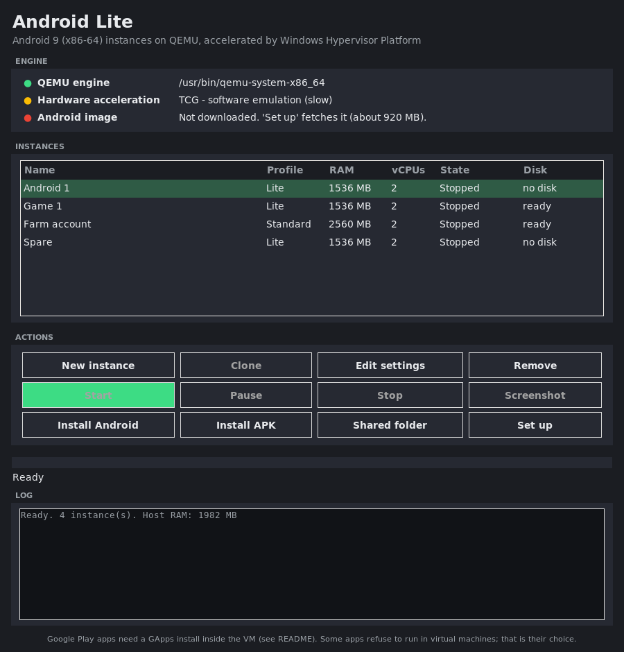
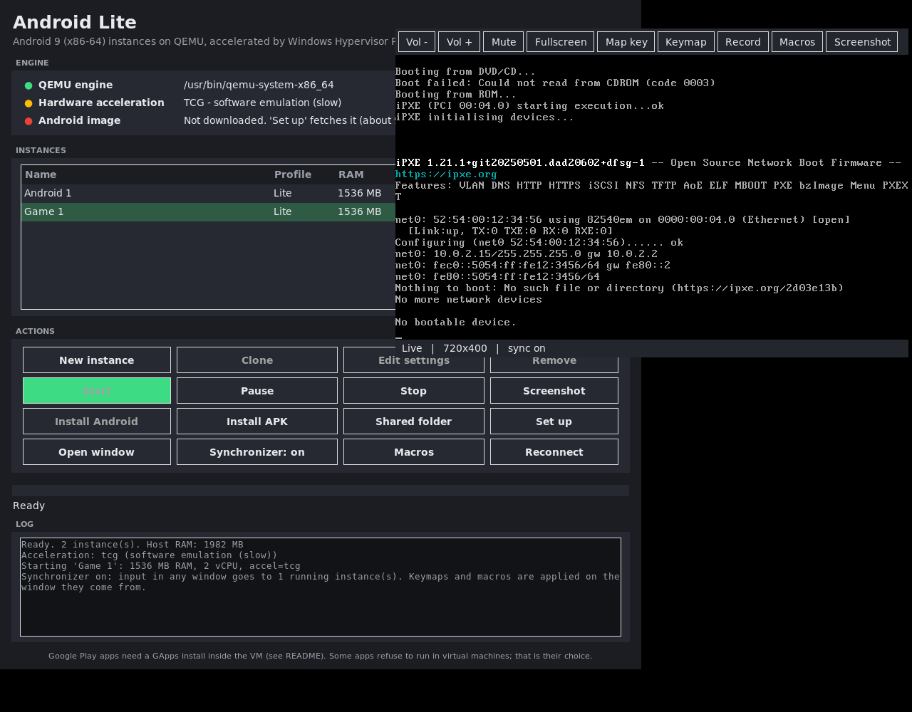
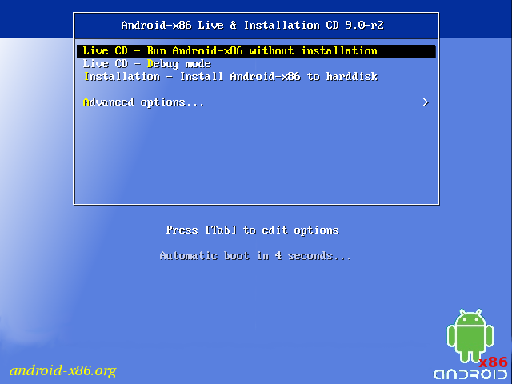

# Android Lite: UI reference

Screenshots are real captures from the running app under a virtual X display (Linux, Tk 8.6). Windows uses its own fonts and window frame, but the layout and controls are the same.

## Main window (instance manager)

| Area | What it shows |
|---|---|
| **Engine** | QEMU path, acceleration (`WHPX` on Windows with Hypervisor Platform on, `TCG` = software emulation), and whether the Android image is downloaded. |
| **Instances** | One row per instance: name, profile, RAM, vCPUs, state (Stopped / Starting / Running / Paused / Stopping) and disk (ready / no disk). Double-click a row to start it. |
| **New instance** | Name, profile (Lite 1.5 GB / Standard 2.5 GB), RAM, vCPUs. Creates an empty sparse 8 GB disk. |
| **Clone** | Copies the selected instance's disk, so installed apps and logins come along. Needs an installed disk. |
| **Edit settings** | Rename or change RAM (1–16 GB) and vCPUs (1–16). Values are clamped to these ranges. |
| **Remove** | Deletes the instance's folder (disk and shared folder) after confirmation. |
| **Start** | Boots the selected instance and opens its window. Warns if the total RAM of running instances would exceed about 85 % of this PC's RAM. |
| **Pause / Resume** | Freezes the guest. A paused instance uses almost no CPU, so you can keep others running. |
| **Stop** | Asks Android to power off. After 20 s it force-quits QEMU. |
| **Screenshot** | Saves a PNG of the instance's screen to the `screenshots` folder. |
| **Install Android** | Boots the Android-x86 installer in that instance and opens its window. Asks first if the disk already has data. |
| **Install APK** | Copies an `.apk` into the instance's shared folder. Then open the Files app in Android and tap it. |
| **Shared folder** | Opens the instance's shared folder on the PC. It appears to Android as a USB drive. |
| **Set up** | One-time: installs QEMU for your user and downloads the Android-x86 9.0 ISO. |
| **Open window** | Opens (or brings forward) the window of the selected running instance. |
| **Synchronizer: on / off** | When on, input in any instance window goes to every running instance. |
| **Macros** | Lists recorded macros. **Play** sends one to every running instance. |
| **Reconnect** | Looks again for instances that were started by an earlier session. |

## Instance window

The window shows the Android screen at 1:1 scale (about 3 frames per second). It opens on the right edge of the screen when an instance starts. On a 1280-pixel-wide screen it overlaps the right part of the main window; drag it aside as needed.

| Control | What it does |
|---|---|
| **Vol −, Vol +, Mute** | Send the volume-down, volume-up and mute media keys to Android. |
| **Fullscreen** (or F11) | Toggles fullscreen. The screen stays at 1:1 and is centered. |
| **Map key** | Start a key mapping. Press the key, then click where it should tap. Press Esc to cancel. |
| **Keymap** | Lists the mappings of this instance, and deletes the selected ones. |
| **Record / Stop** | Records the input you send, with timing, into a macro. Stop asks for a name. |
| **Macros** | Lists recorded macros. **Play** plays one on this instance (or on every instance, when Synchronizer is on). |
| **Screenshot** | Saves the current screen as a PNG in the `screenshots` folder. |
| **Status bar** | Shows Live, Connecting, or "VM is not responding"; the screen size; and whether Synchronizer or recording is on. |

Input:

- Left-click and drag act as touch. Right-click and middle-click send the matching buttons.
- Letters, digits, common punctuation, Enter, Backspace, Tab, Esc, arrows, Home/End, Page Up/Down, and F1–F12 are sent as keys. Shift is applied for capitals and shifted symbols.
- Mapped keys (green circles on the screen) tap their position and are not sent as keys.
- When the window loses focus, held keys and buttons are released, so nothing stays stuck.

Closing the window does not stop the instance. Reopen it with **Open window**.

## Boot flow reference (captured earlier, same engine)

The Android-x86 GRUB menu appears with Live CD, Debug mode, Installation, and Advanced options. **Install Android** boots the Installation path.

The boot reached Android's root console (`console:/ #`), so the kernel and init came up. The Android home screen was not captured, because software emulation is very slow in the test sandbox.

## Command-line equivalents

| Action | Command |
|---|---|
| Status | `AndroidLite status` |
| Set up | `AndroidLite setup` |
| New instance | `AndroidLite new "Game 1" --profile lite` |
| Clone | `AndroidLite clone "Game 1" "Game 2"` |
| Edit | `AndroidLite edit "Game 2" --ram 2048 --cpus 2` |
| Install / start (headless) | `AndroidLite install ID` / `AndroidLite start ID` |
| Open the window | `AndroidLite view ID` |
| Pause / resume / stop | `AndroidLite pause ID` / `resume ID` / `stop ID` |
| Screenshot | `AndroidLite screenshot ID --out shot.png` |
| List macros / play one | `AndroidLite macros` / `AndroidLite play NAME --to ID` |
| Install APK | `AndroidLite apk app.apk --to ID` |
| Remove | `AndroidLite remove ID` |
| List | `AndroidLite list` |

`ID` can be the instance id or its name. Omit it to use the main instance.
