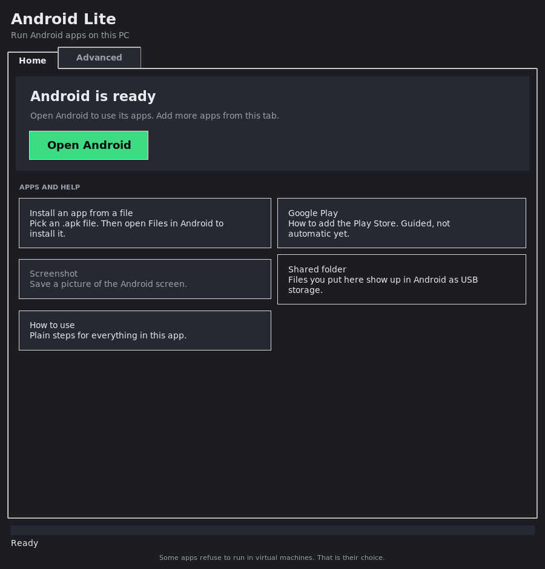

# Android Lite 1.2

A lightweight Windows 11 app for running Android 9 (Android-x86) in QEMU, accelerated by the Windows Hypervisor Platform (WHPX). You can run several Android instances, each with its own apps and data.



The app has two tabs. **Home** is for everyday use: one button opens Android, and tiles add apps or show help. **Advanced** is the full instance manager for running several copies of Android (see the [Advanced tab screenshot](docs/screenshots/ui-03-advanced-tab.png)).

Each control is explained in [docs/UI_REFERENCE.md](docs/UI_REFERENCE.md).

## Features

Each running instance opens in its own window. The window shows the Android screen and sends your mouse and keyboard to it. The app does not use a separate emulator window.

| Feature | Status | Notes |
|---|---|---|
| Home tab | Yes | Guided setup, then an "Open Android" button. Tiles for installing an APK, Google Play steps, screenshots, the shared folder and help. |
| Multi-instance manager | Yes | On the Advanced tab: new, clone, edit, remove. Each instance has its own disk and shared folder. |
| Clone instance | Yes | Copies the disk, so apps and logins carry over. All-zero 1 MB blocks are skipped. |
| Per-instance RAM and vCPUs | Yes | RAM 1–16 GB, vCPUs 1–16. |
| Lite profile | Yes | 1.5 GB per instance. Lite is the default below 8 GB of host RAM. |
| RAM budget check | Yes | Warns before starting an instance that would overcommit RAM (about 85 % of host RAM). |
| Pause / resume | Yes | Freezes an instance so the others keep the CPU. |
| Screenshot | Yes | PNG, saved under `screenshots`. From the window or the main app. |
| Instance window | Yes | Shows the live screen (about 3 frames per second) and sends mouse and keyboard. |
| Fullscreen | Yes | Button or F11. |
| Volume and mute | Yes | Vol −, Vol +, Mute. Sent to Android as media keys. |
| Keymapping | Yes | "Map key": press a key, then click the spot it should tap. Stored per instance in `keymap.json`. Green circles show mapped keys. |
| Synchronizer | Yes | Input in any window goes to every running instance. Keymapped taps are sent as the taps they become. |
| Macros | Yes | "Record" captures the input you send, with timing. "Macros" plays one back, to this window or, from the main app, to every running instance. |
| Install APK | Partly | Copies the APK into the shared folder. Installing from Android's Files app is untested. |
| Shared folder | Partly | Exposed to Android as a USB drive. Whether Android mounts it is untested. |
| Reconnect | Yes | Running VMs keep going when the app closes, and the main window reconnects to them. "Reconnect" looks again. |
| Virtual GPS, shake, rotation | Not yet | These need a helper app inside Android. That is a separate project. |
| Per-instance resolution / DPI | Not yet | Android-x86 takes its resolution from the boot options. |
| Root toggle, device spoofing | Not planned | Out of scope. |

Lite stays small. The app is one Python package with no third-party libraries. The code is in `android_lite/`:
`core.py` (QEMU, VM start and stop), `vmio.py` (input and frames over QMP), `viewer.py` (the instance window), `automation.py` (keymaps and macros), `instances.py` (the registry), `gui.py` and `cli.py`.

## Dependencies

| Item | Needed for | Source | Type |
|---|---|---|---|
| Windows 11 with virtualization | Acceleration | BIOS/UEFI | System |
| Windows Hypervisor Platform | WHPX | Windows Features (one reboot) | System feature |
| `AndroidLite.exe` | The app | `build.bat` or `build_msix.ps1` | Built |
| `qemu-system-x86_64.exe` | VM engine | Installed once, or bundled with `-QemuDir` | External exe |
| Android-x86 9.0-r2 ISO | OS image | Downloaded once (about 920 MB) | Data |

## Commands

```
AndroidLite.exe                       open the GUI
AndroidLite.exe status                engine, acceleration, RAM, instance states
AndroidLite.exe setup                 install QEMU and download the Android image
AndroidLite.exe new "Game 1" --profile lite
AndroidLite.exe install ID            boot the installer in an instance
AndroidLite.exe start ID              boot an installed instance (headless)
AndroidLite.exe view ID               open the window for a running instance
AndroidLite.exe clone "Game 1" "Game 2"
AndroidLite.exe pause | resume | stop ID
AndroidLite.exe screenshot ID --out shot.png
AndroidLite.exe macros                list recorded macros
AndroidLite.exe play NAME --to ID    play a macro on a running instance
AndroidLite.exe apk app.apk --to ID
AndroidLite.exe list | edit | remove
```

`start` and `install` run the instance without a window and print how to open one. Use `view` from another terminal, or use the GUI, which opens the window for you. Macros are recorded in the window (Record, then Stop) and saved there.

From source: `python main.py <command>` (any OS with Python 3.10+; use `ALITE_HOME` for a custom data folder and `ALITE_QEMU` for an existing QEMU).

## Build

```
build.bat                                   dist\AndroidLite.exe (single file, GUI)
.\packaging\build_msix.ps1 -Publisher "CN=YourPublisher" -QemuDir C:\qemu-portable
```

The MSIX script builds the exe, stages the package, stamps version and publisher, runs MakeAppx, and signs if you pass `-PfxPath`. An unsigned MSIX will not install.

## First run

1. Open the app. On the Home tab, click **Set up now**. This installs QEMU for your user (no admin rights) and downloads the Android image (about 1 GB).
2. Click **Install Android**. The steps dialog explains the installer; then click **Start the installer**. In the Android-x86 installer: Installation, create a partition, ext4, install GRUB, reboot. Choose Power off at the end, then click **Stop Android**. The installer steps are written from Android-x86's menus and have not been walked through on Windows.
3. Click **Open Android**. Later, the same button shows Android's window. Use the tiles to install an `.apk` file or to read the Google Play steps.
4. For more copies of Android (separate accounts or games), use the Advanced tab: **New instance** or **Clone** after installing once.

## Input and the window

- Left click and drag act as touch. Right and middle click send the matching mouse buttons.
- Letters, digits, punctuation, Enter, Backspace, arrows, Tab, Esc, and F1–F12 are sent as keys. Keys with no mapping are not sent.
- Keymap: click **Map key**, press the key, then click where it should tap. **Keymap** lists and deletes mappings. Mappings are stored per instance in `keymap.json`, with positions as fractions of the screen so they work at any size.
- When the window loses focus, all held keys and buttons are released, so nothing stays stuck.
- Synchronizer (main window button) sends input from any window to all running instances. Use it for identical setups; keymaps are resolved on the window that receives your input.
- Macros are stored in the data folder under `macros/` as JSON. Use the window's **Macros** button, or the main window's button to play on all running instances.

## Google Play

Android-x86 ships without Google services. Install a GApps package (for example MindTheGapps; match it to Android 9 x86_64) inside each instance. This is manual, and I have not verified the procedure for this build. The **Google Play** tile on the Home tab shows the steps, and its shared-folder button opens the folder you copy the package into. The app does not automate installing the package. Some apps check Play Integrity and may refuse to run in a VM; the app does not try to get around those checks.

## Disk and memory

- Disks are raw and sparse. On Windows they are marked sparse (NTFS), so an 8 GB instance should use only what it writes. The NTFS path is untested.
- Each running instance reserves its full RAM. The app checks the total against about 85 % of this PC's RAM before starting one.
- Data folder: `%LOCALAPPDATA%\AndroidLite\` (inside the MSIX container when packaged). Logs: `logs\alite.log` and `logs\qemu-<id>.log`. Screenshots: `screenshots\`.

## Verified in this sandbox

Linux, QEMU 10.0.13, software emulation (no WHPX here). The tests are in `tests/`: `test_core.py` (26) and `test_features.py` (29). Run them with `python -m unittest discover -s tests -v`.

- 55 of 55 tests pass. This includes a real VM test: it starts QEMU headless with the app's device set and a shared-folder drive, pauses and resumes it, takes a PNG screenshot, and force-stops it. The newer tests cover the Home tab's states, the short viewer toolbar (Fullscreen and Screenshot, with the rest under More), and the installed marker.
- End-to-end input: the app's window sent an F12 keypress through its keyboard handler to a live VM. The guest screen changed (SeaBIOS's boot menu, then iPXE), and the window showed the result.
- The Home tab's Open Android button launched an instance, and the window opened with live frames while the Home tab showed "Android is running". Screenshot: `docs/screenshots/ui-04-android-window.png`. The Synchronizer button toggled and the log reported it.
- Not tested: mouse taps, macros, and synchronized input against a running Android. The sandbox boot was too slow to reach the home screen.
- An earlier single-instance build booted the Android-x86 9.0-r2 ISO to the GRUB menu and to Android's root console.

## Not verified yet

- Everything on Windows: WHPX, the silent QEMU installer, sparse disks on NTFS, the `--windowed` exe, and the MSIX.
- Whether the volume and mute keys change the sound level inside Android-x86. They are sent as standard media keys.
- The Home tab's guided install and Google Play steps, end to end, including the ~10-minute estimate shown in the install dialog. The Android-x86 installer menus were not walked through here.
- Keymapping, Synchronizer and macros against an Android home screen. The sandbox boot was too slow to reach it, so these were checked only at the level of the keys and taps sent to the guest.
- Whether Android mounts the shared folder as USB storage, and whether the APK installer in Android's Files app picks it up.
- The ISO's SHA256. No official value was found, so none is enforced. Set `iso_sha256` in settings to enforce one.
- Microsoft Store policy may restrict runtime downloads of executables. Bundling QEMU with `-QemuDir` avoids that, at the cost of package size.

## Layout

```
main.py                    entry point (GUI, or CLI subcommands)
android_lite/config.py     paths, profiles, settings, RAM detection and budget
android_lite/instances.py  instance registry: create, clone, edit, remove, ports
android_lite/core.py       QEMU install, VM start/stop/pause, APK staging
android_lite/qmp.py        QMP client (one call at a time per VM), screen dumps, PPM to PNG
android_lite/vmio.py       input events, per-VM sender thread, key mapping to QEMU codes
android_lite/viewer.py     the instance window: screen, keys, touch, keymap, macros
android_lite/automation.py keymap and macro storage, recorder
android_lite/disk.py       sparse raw disks (stdlib, ctypes for NTFS)
android_lite/gui.py        Tkinter UI: Home tab and Advanced tab (instance manager)
android_lite/cli.py        command-line subcommands
tests/                     test_core.py, test_features.py
build.bat, packaging/      Windows build and MSIX
docs/                      UI reference and screenshots
```
